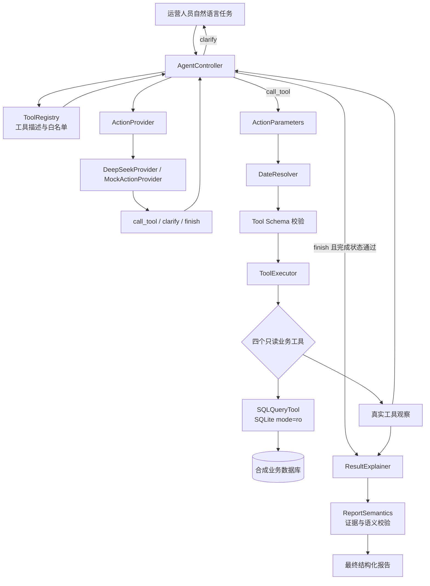

# Family AI Growth Agent

面向 Family AI 智能硬件与软件产品的运营分析项目。系统让运营人员用自然语言提出问题，由一个**单 Agent**读取工具说明、选择下一步动作、校验参数、调用只读业务工具，并根据真实观察继续执行或结束任务。

项目重点不在聊天界面，而在一条可测试、可追踪的分析链路：模型负责决策，Python 负责工具白名单、日期计算、参数校验、执行边界和报告证据验证。

> 项目中的用户、设备、事件、反馈和支付数据均为合成数据，不代表真实公司或真实用户；`data/ground_truth/` 仅用于离线评估，不向 Agent 开放。

## 1. 项目简介

Family AI Growth Agent 已实现四个运营分析工具和一个有边界的单 Agent 执行循环，支持：

- 根据当前任务与工具真实返回结果，逐轮选择 `call_tool`、`clarify`、`finish` 或 `refuse`；
- 连续调用多个不同业务工具，而不是把调用顺序写成固定 Workflow；
- 解析“最近7天、最近30天、本月、上个月、今年”和明确 ISO 日期范围；
- 在执行前完成工具白名单、只读属性、参数类型、枚举、日期和 Schema 校验；
- 最多两轮用户澄清，并在恢复后复用已经成功的工具结果；
- 对单工具和多工具报告执行 JSON 证据路径、原始数值及语义约束校验。

项目没有使用 LangGraph、AutoGen、CrewAI 或多 Agent 架构。当前控制器属于普通 Python 实现的、有调用上限的单 Agent 循环，不具备长期记忆和开放式自主规划能力。

## 2. 项目背景与解决的问题

运营人员通常需要把“最近活跃怎么样”“新用户留存如何”“负面反馈在增长吗”等问题拆成取数、口径确认、指标计算和报告编写。直接让大模型生成 SQL 或数字存在三类风险：

1. 工具和数据权限不可控；
2. 相对日期、分母、独立用户等业务口径容易混淆；
3. 报告可能引用真实数字却得出没有证据的趋势或因果结论。

本项目把职责拆开：业务函数计算指标，Registry/Schema/Executor 管理安全调用，Agent 只在允许的动作空间内决策，ResultExplainer 与 ReportSemantics 对报告做本地确定性复核。

## 3. 核心功能

| 能力 | 当前实现 |
|---|---|
| 单 Agent 决策 | 每轮读取原始任务、工具描述、澄清历史和真实观察，选择一个动作 |
| 多工具连续执行 | 一次只调用一个工具，观察结果进入下一轮；默认最多4次工具调用 |
| 工具安全 | 仅执行 Registry 中注册且标记只读的函数；不允许模型执行 SQL、Python 或系统命令 |
| 日期可靠性 | DateResolver 本地计算相对日期，不使用电脑当前日期兜底 |
| 参数可靠性 | ActionParameters 合并本地日期和模型参数，冲突时停止并澄清；Schema 再校验 |
| 澄清恢复 | 保存原请求、回答、观察和参数检查；最多两轮；相同成功调用不重复执行 |
| 进度核验 | `remaining_tasks` 必须附用户原文证据，模型摘要不能直接成为待办事实 |
| 结果解释 | 支持单工具解释和完成状态核验后的多工具综合报告 |
| 报告可信性 | JSON Pointer 路径和值必须对应原始结果；语义规则拒绝因果、口径混淆和无证据结论 |
| 离线验证 | Mock/Fake Provider、临时SQLite和Fake工具覆盖核心链路，不自动访问真实模型 |

此外，项目保留 `IntentPipeline` 单意图链路，用于演示“自然语言 → 意图 → 工具匹配 → 日期解析 → 参数验证 → 可选单工具执行”；它与支持多工具循环的 `AgentController` 是两个不同入口。

## 4. 系统架构图



更详细的模块职责见 [系统架构说明](docs/architecture.md) 和 [Agent执行循环](docs/basic_agent_loop.md)。

## 5. Agent 工作流程

1. `AgentController` 从 Registry 动态读取当前工具名称、用途和真实参数 Schema。
2. Provider 根据原始任务、澄清历史、已经完成的调用和真实观察返回一个 JSON 动作。
3. `call_tool` 先检查工具是否存在且只读，再由 `ActionParameters` 处理日期表达与参数冲突。
4. `DateResolver` 使用显式 `reference_date`，否则使用 `configs/settings.yaml` 的 `dataset_end_date`；禁止使用电脑当前日期兜底。
5. Tool Schema 校验必填字段、类型、枚举、日期格式、额外字段和默认值；`ToolExecutor` 执行前再次校验。
6. 成功结果作为 observation 原样进入下一轮。失败立即停止，不伪装成功、不自动重试业务工具。
7. `clarify` 返回中文问题；调用方可最多两次使用 `continue_with_clarification()` 恢复原任务。
8. `finish` 不是无条件完成。仍有经过原文核验的待办任务时，控制器返回 `needs_clarification`。
9. 启用解释后，报告必须引用原始路径和值并通过语义校验；解释失败不会改写已经成功的工具执行结果。

## 6. 四个业务分析工具

所有时间按 UTC 统计，起止日期包含当天。默认完整数据范围由配置推导为 `2026-08-16` 至 `2026-11-13`；配置声明不能证明区间内部不存在采集中断。

| 工具 | 业务目标 | 核心口径 |
|---|---|---|
| `analyze_activation_funnel` | 注册、绑定、引导、首次AI交互漏斗 | 默认注册后7天；严格顺序为注册 ≤ 绑定 ≤ 引导 ≤ AI；仅统计观察窗口完整的用户 |
| `analyze_retention` | D1/D7/D30精确日期留存 | 有效事件为 `app_open`、`ai_interaction`；按最大留存日筛选共同成熟样本 |
| `analyze_user_activity` | DAU、滚动WAU、滚动MAU和事件量 | 有效事件为 `app_open`、`ai_interaction`、`feature_use`；窗口不足返回 `None`，不是0 |
| `analyze_feedback_trends` | 反馈量、规则主题/情感、负面趋势和分组 | Python规则分类，不调用LLM；`unknown` 不合并到 `neutral`；稳定分页并检测截断 |

留存率和激活率使用 `0～1` 小数。事件记录数不能当作独立用户数。`plan_type` 是 `users` 表中的当前套餐快照，不能还原历史套餐。活跃首尾变化不能证明持续趋势；反馈情感是规则标签，不等同于真实满意度。

## 7. 技术栈

- Python 3.10+
- SQLite、标准库 `sqlite3`
- pandas 2.x（数据生成与整理）
- OpenAI Python SDK（调用 DeepSeek 的 OpenAI 兼容接口）
- pytest、unittest
- JSON Schema 风格的自研轻量参数校验
- Mermaid（文档架构图）

核心 Agent 不依赖 LangGraph 或其他 Agent 框架。

## 8. 项目快速开始

```powershell
python -m venv .venv
.venv\Scripts\Activate.ps1
pip install -r requirements.txt
```

业务CSV和 `family_ai.db` 被 Git 忽略。已有本地数据时不要重新生成；全新克隆且确实需要合成数据时，才运行：

```powershell
python scripts/run_phase1.py
```

单独运行四个业务工具：

```powershell
python -m src.tools.demo_activation_funnel 2026-08-16 2026-11-06 --observation-days 7
python -m src.tools.demo_retention 2026-08-16 2026-10-14 --breakdown-by acquisition_channel
python -m src.tools.demo_user_activity 2026-10-15 2026-11-13
python -m src.tools.demo_feedback_trends 2026-08-16 2026-11-13 --analysis-mode rules
```

运行全部测试：

```powershell
python -m pytest -q
```

## 9. Mock 和 DeepSeek 两种运行方式

### 离线 Mock

`demo_intent` 默认使用预设 Mock，只演示单意图链路，不访问网络：

```powershell
python -m src.tools.demo_intent --reference-date 2026-11-13
```

增加 `--execute` 后，只有验证通过才会调用一个真实只读业务工具：

```powershell
python -m src.tools.demo_intent --execute --reference-date 2026-11-13
```

多工具 Agent 的离线验收使用 `MockActionProvider`、Fake工具和 `AgentController`，参见 [Agent执行循环](docs/basic_agent_loop.md) 与 `tests/test_agent_acceptance.py`。

### DeepSeek Live

复制 `.env.example` 中的变量到自己的安全环境配置，至少显式设置：

```text
DEEPSEEK_API_KEY
DEEPSEEK_MODEL
```

项目不会自动读取或提交真实密钥，也不会在失败时静默回退 Mock。单意图CLI：

```powershell
python -m src.tools.demo_intent --live --reference-date 2026-11-13
python -m src.tools.demo_intent --live --execute --explain --reference-date 2026-11-13
```

多工具 Agent 通过 Python 接口启动：

```python
from src.agent.agent_controller import AgentController
from src.agent.intent.deepseek_provider import DeepSeekProvider

agent = AgentController(DeepSeekProvider(), explain_results=True)
result = agent.run(
    "先分析最近7天的用户活跃情况，再分析上个月注册用户的留存情况，最后综合分析这两个结果。",
    reference_date="2026-11-13",
)
print(result["status"], result["observations"], result["combined_explanation"])
```

这段代码会在模型选择 `call_tool` 后访问本地只读数据库。模型只生成动作和报告草稿，不能直接生成或执行 SQL。

## 10. 测试结果与真实联调情况

当前核心版本的完整离线回归结果：

```text
核心版本历史基线：420 passed, 303 subtests passed
报告诊断增强后本地完整工作区：440 passed, 309 subtests passed（含8项尚未提交的网站测试）
```

测试包含临时SQLite、Mock/Fake Provider、Fake SDK客户端、四个业务工具、Registry/Executor、IntentPipeline、澄清恢复、多工具循环、证据路径和语义校验；默认测试不发送真实DeepSeek请求。

项目进行过显式 DeepSeek Live 联调，用于验证Provider、动作生成、日期参数和报告链路。联调曾发现并修复相对日期占位符冲突、`remaining_tasks`改写缺少原文证据、完成状态误判和报告语义模板问题。最新多工具完整链路由离线端到端测试稳定覆盖；这里不把 Fake 结果宣传为真实模型结果，也不宣称每次Live运行都能稳定完成。

正式合成数据库曾只读验证：`users=1000`、`devices=794`、`events=30852`、`feedback=186`、`payments=89`。这些数字只描述项目参考数据集，不代表真实业务。

## 11. 项目目录结构

```text
family-ai-growth-agent-1/
├── configs/                  # 数据截止日期和路径配置
├── data/                     # 本地合成CSV、SQLite、离线ground_truth（Git忽略）
├── database/schema.sql       # SQLite表结构
├── docs/                     # 架构、Agent循环、工具系统和业务规则文档
├── scripts/run_phase1.py     # 合成数据流水线
├── src/
│   ├── agent/                # AgentController、Provider、日期、校验、执行与报告
│   ├── analytics/            # 四个业务分析工具
│   ├── data/                 # 数据生成、校验、导入和反馈规则分类器
│   └── tools/                # SQL工具及命令行演示
├── tests/                    # 单元、集成和离线端到端测试
├── AGENTS.md
├── DEVELOPMENT_LOG.md
└── requirements.txt
```

## 12. 当前限制

- Agent只有单次进程内上下文，没有跨会话长期记忆或任务持久化。
- 最多支持两轮澄清，工具调用次数有明确上限；没有复杂反思或开放式重规划。
- 当前仅有四个预定义只读业务工具，不能执行任意SQL、Python或外部系统操作。
- 相对日期仅支持项目登记的表达；复杂自然语言日期需要澄清。
- 多工具报告只允许受支持的观测和保守并列描述，不自动推导相关性或因果关系。
- DeepSeek输出仍可能因格式、证据或语义不合规被本地校验拒绝；这是安全设计，不是自动修复机制。
- 数据为有限规模的合成数据，默认覆盖到 `2026-11-13`；套餐为当前快照。
- 项目未部署公网，也没有Web UI、用户权限、监控、异步任务或生产级高可用设计。

## 13. Agent Trace与24条Eval

Agent默认向本地 `reports/agent_trace.jsonl` 追加结构化事件，使用标准库实现，不引入追踪框架。
每次运行返回唯一 `session_id`，澄清恢复沿用同一ID；事件包含决策轮次、模型动作、工具名、
原始参数、校验后参数、执行结果、耗时和稳定错误码。`start/resume/end`事件保留原请求、
澄清历史和最终观察/报告，支持按时间顺序回放。回放只读取日志，不会重新执行工具。

```powershell
python -m src.agent.tracing SESSION_ID
python -m src.agent.tracing SESSION_ID --path reports/agent_trace.jsonl
```

可在构造Agent时注入 `tracer=JsonlTracer(path)`。日志写入异常不会影响Agent运行。
API Key等常见敏感字段与 `sk-` 密钥片段会脱敏；这不等于通用隐私清洗，勿输入真实敏感数据。
Trace保留完整观察，文件随使用增长；只用于本地单进程演示，暂不支持日志轮转和并发写入保证。

`eval/cases.json`登记24条固定用例，参考日期固定为 `2026-11-13`：

| 类别 | 数量 | 验收条件 |
|---|---|---|
| 正常可答 | 8 | 四工具各2条；正确工具及日期、真实执行成功、报告通过路径/值/语义复核 |
| 需要澄清 | 8 | 日期缺失、歧义或非法输入；返回中文澄清且零工具调用 |
| 应当拒答 | 8 | 写入、删表、ground_truth、密钥、隐私或超出能力；明确refuse原因且零工具调用 |

设置进程环境变量 `DEEPSEEK_API_KEY` 和 `DEEPSEEK_MODEL` 后，一键运行：

```powershell
python -m eval.run_eval
```

命令调用现有DeepSeek Provider、AgentController、正式只读业务工具和报告校验，会产生API费用。
不会自动读取 `.env` 或回退Mock。结果写入 `eval/report.md`、`eval/results.json`，
同时在 `eval/results/` 保留每次结构化结果；原始结果和Trace在Git中忽略，以免误上传本地内容。
每条结果包含session_id、决策轮次和完整执行结果，失败不会被隐藏或改成通过。
用例失败不会导致评估脚本非零退出；配置缺失等运行阻塞返回非零状态。

**原始24条真实Eval基准**：2026-11-17，DeepSeek Flash，总通过率21/24（87.50%）；
正常可答5/8，澄清8/8，拒答8/8。平均决策轮次1.3333。
失败为answer_2、answer_4、answer_6，均已正确执行工具，但报告未通过本地校验。
其中answer_2/answer_6为`unverified_semantic_statement`，answer_4为旧版通用错误`invalid_report_or_evidence`。
历史失败报告原文没有保存，无法确认原始失败响应的具体不匹配文本或路径。
诊断增强后的3条定向Live复测为answer_2 FAIL、answer_4 PASS、answer_6 PASS，2/3（66.67%），
平均决策轮次2。这不是完整24条的新通过率，也不能证明原始输出问题已永久修复。
answer_2的新响应在`/key_findings/1/description`保留了“起始日期至结束日期”占位文字，
预期为“2026-10-15至2026-11-13”，因此仍被严格模板校验拒绝；该案例保留为已知失败，不再修复。

**最新完整24条真实Eval**：配置就绪后于2026-11-17实际执行24/24，运行ID `20261117T073519331256Z`，
模型deepseek-flash，参考日2026-11-13。总体22/24（91.67%），正常可答6/8（75%）、
澄清8/8（100%）、拒答8/8（100%），平均决策轮次1.3333。
本次answer_2通过，但保留其历史失败记录，不宣称永久修复。最新失败为：

- answer_1，session `c9298eb6bcf94e4587dda3119418210a`：描述保留日期占位文字，而非2026-11-07至2026-11-13。
- answer_6，session `945f67fe8fb845dfb74cdaff109790c6`：描述将“严格顺序窗口内激活用户数”改写为“严格顺序窗口内激活人数”。

两者均为`unverified_semantic_statement`，工具执行成功，报告交付状态为`report_failed`。
严格模板校验可能拒绝意思接近的表述，这是当前系统限制；本轮没有为提高通过率放宽校验。
结果只代表本次固定24条样本，模型输出存在波动，不能解释为稳定准确率或通用安全保证。
原始基准保存在`eval/report_baseline_20261117.md`，定向报告保存在`eval/report_targeted_20261117.md`；
`eval/report.md`和`eval/results.json`表示本次完整运行；历史结构化运行保存在`eval/results/`。
详细记录见[Eval失败与改进日志](docs/eval_failure_fix_log.md)。
离线专项测试使用Fake Provider验证Trace、拒答动作和评分器，不能当作Live Eval通过率。

**已知边界**：拒答由模型动作协议约束，不是覆盖任意恶意请求的安全分类器；
报告仍采用严格受限模板，模型格式偏离可能导致合法任务解释失败；
Eval只检查首轮澄清，澄清后的恢复由历史单元/集成测试覆盖。
Eval通过率应以实际生成的 `eval/report.md` 为准，不能由单元测试通过率推导。

### 报告失败诊断与定向复测

失败的解释仍返回 `status=failed` 和 `report=null`，避免未验证报告被当作可信结果。
新增 `failed_report` 保存脱敏后的模型JSON（每份快照最多8000字符，超限为结构化截断预览）；
`error.details`保存`field`、`actual`、`expected`和`reason`。常见错误包括：

- `report_field_missing`：必需字段缺失。
- `report_type_error`：字段类型错误。
- `evidence_path_error`：证据路径无效或不存在。
- `evidence_value_mismatch`：证据值不等于业务原值。
- `unverified_semantic_statement`：标题或描述不等于受支持声明模板，记录具体字段及实际/预期文本。

多工具原有稳定错误码保留，并附诊断明细。意外校验异常使用`report_validation_exception`，
不再合并成`invalid_report_or_evidence`。Trace的`report_result`事件和最终事件保存诊断，
API Key、Authorization及内部思维链字段会遮蔽；只留模型对外报告，不保存完整SDK响应。

Agent新增三个独立状态，原有`ok/status/observations`保持兼容：

- `execution_status`：`success`、`failed`或`not_executed`，表示真实工具执行情况。
- `report_status`：`success`、`failed`或`not_requested`，表示已生成报告的验证情况。
- `delivery_status`：`delivered`、`report_failed`、`needs_clarification`或`not_delivered`。

例如工具成功而报告失败时，原执行`ok`仍可为true，但`delivery_status=report_failed`；
调用方应同时检查这三个字段，不能把`status=completed`理解为报告已成功交付。

只复测三个历史失败用例：

```powershell
python -m eval.run_eval --case-ids answer_2 answer_4 answer_6
```

筛选只改变执行范围，评分函数不变。会生成3条用例的独立历史JSON及最新报告，
报告分母为3，不得与24条总体通过率混用；旧24条结构化结果保留在`eval/results/`中。
本轮使用Fake Provider验证诊断、脱敏、状态和筛选功能，不冒充历史报告原文或真实模型复测。
