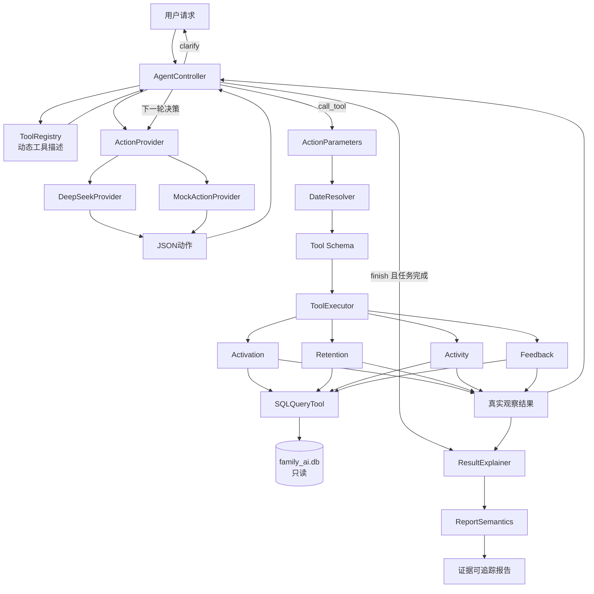

# 系统架构

## 1. 架构目标

Family AI Growth Agent 使用一个有边界的单 Agent 完成运营分析。模型负责在每轮选择下一步动作；Python 代码负责日期、参数、工具权限、执行和报告证据校验。工具调用顺序不是固定 Workflow，也没有把激活、留存、活跃和反馈拆成多个 Agent。

## 2. 总体调用关系

`ResultExplainer` 不调用工具或数据库。它只接收 `ToolExecutor` 的成功结果信封；`ReportSemantics` 再用确定性规则核对路径、原始值、指标口径和允许的表述。

## 3. 核心模块职责

| 模块 | 职责 | 明确不负责 |
|---|---|---|
| `AgentController` | 保存原任务和观察，构建每轮上下文，处理动作、调用上限、澄清恢复、重复调用复用和完成状态 | 不写SQL，不计算业务指标，不信任模型直接宣称完成 |
| `ActionProvider` | 定义动作生成能力；Mock实现提供离线预设响应 | 不执行工具，不做关键词意图分类 |
| `DeepSeekProvider` | 使用OpenAI兼容SDK请求JSON；处理超时、限流、鉴权、截断和非法JSON | 不自动回退Mock，不读取数据库，不保存API Key |
| `ActionParameters` | 核验日期表达来自用户原文，连接DateResolver与真实Schema，记录冲突和最终参数 | 不自行实现日期算法，不执行工具 |
| `DateResolver` | 本地解析相对日期和ISO范围，按工具映射日期字段 | 不使用电脑当前日期，不判断业务数据是否真实完整 |
| `ToolRegistry` | 保存不可变工具定义、描述、Schema、函数引用和只读标记 | 不按用户字符串动态导入代码 |
| `Tool Schema` | 校验必填、类型、日期格式、枚举、范围和额外字段，补充安全默认值 | 不代替业务函数的全部跨字段业务规则 |
| `ToolExecutor` | 只执行Registry函数，执行前再验证，统一成功/失败结果 | 不选择工具，不吞掉工具异常，不执行任意函数名 |
| 四个分析工具 | 通过只读SQLQueryTool查询五张业务表并计算明确指标 | 不读取ground_truth，不生成模型结论 |
| `ResultExplainer` | 为单工具或多工具结果构建报告Prompt，并验证报告结构及证据路径和值 | 不修改原始工具结果，不把解释失败变成工具失败 |
| `ReportSemantics` | 建立指标目录和限制，拒绝口径混淆、无证据结论、持续趋势或因果推断 | 不是通用自然语言事实核查器 |

## 4. 状态与数据流

一次 Agent 运行维护以下关键状态：

- `user_input`：最初用户原文，后续轮次不会用模型摘要覆盖；
- `observations`：已执行工具的名称、最终参数和完整Executor结果；
- `decisions`：每轮模型动作及模型标识；
- `parameter_checks`：日期依据、参考日来源、冲突和Schema校验结果；
- `clarification_history`：问题和用户补充回答，最多两轮；
- `pending_tasks`：只保存能够在用户原文或补充回答中找到的任务证据；
- `reused_calls`：恢复任务时复用的成功调用；
- `completion_verified`：无已核验待办且已有观察全部成功时才为真。

每轮上下文都包含原任务、可用工具、真实观察、澄清历史、已完成调用和剩余调用额度。观察是下一轮决策依据；模型生成的解释不是新的观察。

## 5. 安全边界

1. 模型只能返回 `call_tool`、`clarify`、`finish` 三种JSON动作。
2. 工具名必须存在于当前Registry，并且 `read_only=True`。
3. Agent入口不暴露 `db_path`、`query_runner` 或任意callable。
4. `SQLQueryTool` 使用SQLite只读模式、表白名单和authorizer。
5. 日期和参数必须先通过本地解析与Schema校验，Executor会再次校验。
6. 工具失败立即停止，不自动重试，之前的成功观察仍保留。
7. 默认最多4次工具调用；上下文默认最多60000字符，不静默截断。
8. 报告证据路径必须存在且数值严格相等；综合报告只能保守并列不同工具指标。
9. API Key只从环境变量读取，错误与日志不包含密钥或请求头。
10. `data/ground_truth/` 不属于Agent工具数据源。

## 6. 两条入口的区别

- `IntentPipeline`：面向单个意图，完成解析、匹配、日期解析、参数验证和一次可选执行；`src.tools.demo_intent` 使用该入口。
- `AgentController`：面向可能包含多个子任务的请求，根据每轮观察继续选择工具；通过Python接口调用。

两者复用Registry、Schema、DateResolver和Executor，但职责不同。CLI能够演示单工具链路，不应被描述为多工具Agent CLI。

## 7. 当前边界

系统没有多Agent、长期记忆、任务队列、向量数据库、开放式代码执行、任意SQL、自动反思或公网部署。当前“自主”指模型能在已注册工具和三种动作协议内，根据真实观察动态决定下一步。
