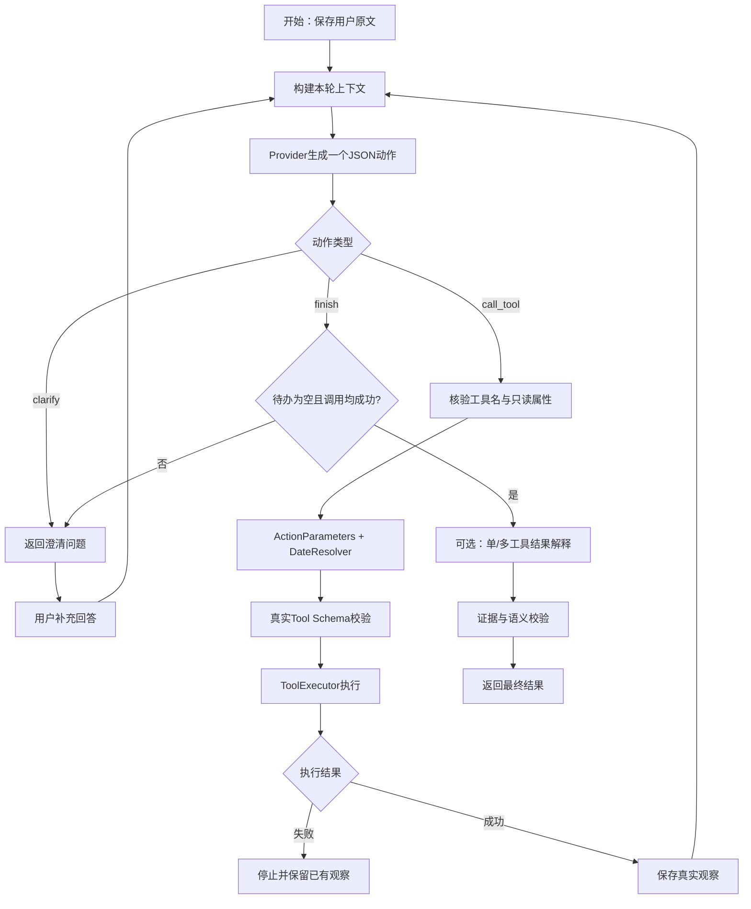

# 单 Agent 执行循环

## 1. 解决的问题

一个运营任务可能同时要求活跃、留存和综合分析。`AgentController` 不把这些步骤写成固定流程，而是在每轮把用户原始任务、当前工具描述和真实工具观察交给同一个Provider，由模型决定下一步。

Python控制器负责约束动作、解析日期、验证参数、执行只读工具、保留状态和核验报告。模型不能直接执行SQL、Python或系统命令，也不能用一句 `finish` 绕过未完成任务检查。

## 2. 执行循环



`run(user_input, reference_date=None)` 创建一次新的本地状态。`continue_with_clarification(previous_result, answer)` 只接受此前真实返回的 `needs_clarification` 结果，并从防御性拷贝恢复任务。

## 3. 三种动作

Provider每轮只能返回一种合法JSON动作。

### call_tool

```json
{
  "action": "call_tool",
  "tool_name": "analyze_user_activity",
  "arguments": {},
  "date_expression": "最近7天",
  "remaining_tasks": [
    {
      "summary": "留存分析",
      "evidence": "再分析上个月注册用户的留存情况"
    },
    {
      "summary": "综合分析",
      "evidence": "最后综合分析这两个结果"
    }
  ]
}
```

每次只执行一个工具。`date_expression` 必须是用户原文片段；`remaining_tasks` 推荐把模型摘要和用户逐字证据分开。兼容直接返回原文字符串，但不能用模型改写替代证据。

### clarify

```json
{
  "action": "clarify",
  "question": "你希望分析最近多少天的用户留存情况？"
}
```

信息不足、日期冲突、Schema不完整或模型无法提供任务原文证据时，控制器停止执行并把问题交给用户。

### finish

```json
{
  "action": "finish",
  "remaining_tasks": []
}
```

`finish`只表示模型选择停止。控制器还会检查：

- 已核验的待办任务是否为空；
- 是否至少有一个真实观察；
- 所有已执行工具是否成功。

如果仍有待办，返回 `needs_clarification/unfinished_tasks`，不会把任务标记为完成。

## 4. 工具发现与选择

每轮调用 `registry.get_tool_descriptions()`，得到当前工具的名称、业务用途、只读属性和真实Schema。Registry发生变化时，下一轮立即读取新状态，不使用写死的旧工具列表。

模型只能从这些工具中选择：

- `analyze_activation_funnel`
- `analyze_retention`
- `analyze_user_activity`
- `analyze_feedback_trends`

AgentController根据精确名称再次查询Registry，并拒绝不存在或非只读工具。它不使用字符串相似度动态导入函数。

## 5. 原始任务和真实观察如何进入下一轮

每轮Provider上下文包含：

- 完整 `user_input`；
- Registry当前工具描述；
- 完整 `observations`；
- 澄清问答历史和所有用户消息；
- 已复用调用；
- 原始任务、已核验待办和已完成调用摘要；
- 参考日期和剩余工具调用次数。

观察记录以下内容：

```json
{
  "call_index": 1,
  "tool_name": "analyze_user_activity",
  "arguments": {
    "start_date": "2026-11-07",
    "end_date": "2026-11-13"
  },
  "result": {
    "ok": true,
    "tool_name": "analyze_user_activity",
    "data": {},
    "error": null,
    "metadata": {"execution_status": "success"}
  }
}
```

下一轮读取的是Executor真实结果，不是模型对结果的复述。可选解释不会回流成工具观察。

## 6. 日期解析与参数冲突

`ActionParameters` 不实现日期运算，而是连接用户证据、`DateResolver`和真实Schema。

处理规则：

1. 核验显式 `date_expression` 能在原任务或澄清回答中找到；
2. 只有一个支持的相对表达时可自动定位；多个日期范围时要求本次动作明确选择原文片段；
3. DateResolver 本地支持最近7天、最近30天、本月、上个月、今年及明确ISO范围；
4. 参考日期优先使用调用方参数，否则读取配置的 `dataset_end_date`，不使用电脑当前日期；
5. 激活/留存映射为 `cohort_start/cohort_end`，活跃/反馈映射为 `start_date/end_date`；
6. 模型把“最近7天”重复填入两个日期字段时，将其识别为占位符；
7. 模型自行推导、但用户没有明确提供的ISO日期不能覆盖本地相对日期结果；
8. 用户明确给出的ISO日期与本地结果冲突时，保留双方并请求澄清；
9. 起止日期不完整、格式无效、表达不支持或起始晚于结束都会停止执行。

例如参考日为 `2026-11-13`：

- 最近7天 → `2026-11-07` 至 `2026-11-13`；
- 上个月 → `2026-10-01` 至 `2026-10-31`。

参数检查轨迹保存在 `parameter_checks`，包括原参数、日期表达、参考日来源、本地解析、标准化字段、冲突和最终参数。

## 7. Schema校验与工具执行

ActionParameters调用工具定义中的真实 `schema.validate()`：

- 拒绝缺少必填字段；
- 拒绝多余字段和类型错误；
- 检查日期格式、枚举、整数范围和数组唯一性；
- 补充Schema默认值；
- 检查通用起止日期顺序。

通过后才调用 `ToolExecutor.execute()`。Executor从同一Registry重新获取定义并再次验证，然后只调用已保存的Python函数引用。参数错误时工具不会执行；业务工具异常和显式 `ok=False` 都返回失败信封。

## 8. remaining_tasks 原文证据核验

模型可以总结任务，但总结不是用户事实。控制器只把 `evidence` 中能在原请求或澄清回答里逐字找到的内容加入 `pending_tasks`；摘要单独保存在 `pending_task_summaries`。

以下原请求：

> 先分析最近7天的用户活跃情况，再分析上个月注册用户的留存情况，最后综合分析这两个结果。

可核验证据是：

1. `先分析最近7天的用户活跃情况`
2. `再分析上个月注册用户的留存情况`
3. `最后综合分析这两个结果`

“综合分析活跃和留存两个结果”虽然语义接近，但不是用户原文，不能直接进入待办。证据不存在、为空或重复时返回 `unverified_remaining_tasks`。

## 9. 澄清恢复与结果复用

`continue_with_clarification()`：

- 保留原始任务，不用回答覆盖它；
- 单独保存问题和用户回答；
- 保留观察、决策、参数检查和待办；
- 最多允许两轮澄清；
- 空回答、对已完成结果继续澄清或伪造previous_result会被拒绝。

恢复后如果模型再次请求完全相同的成功工具和最终参数，控制器按指纹复用原观察，不重复访问业务工具。一次恢复中反复请求同一已完成调用会返回 `repeated_completed_tool_call`，避免死循环。

## 10. 多工具综合报告

构造函数设置 `explain_results=True` 时：

1. 每个成功工具可调用 `ResultExplainer.explain()`；解释失败不改变工具成功状态。
2. 至少两个不同工具成功、待办为空且 `completion_verified=True` 后，调用 `explain_multiple()`。
3. 综合输入包含每次调用的工具名、最终参数和业务数据。
4. 报告只能引用指标目录登记的JSON Pointer和原始值。
5. 跨工具发现只允许“并列观察”，必须明确不代表相关或因果。

如果任一工具失败，循环停止并保留之前成功结果；不会生成伪成功综合报告。

## 11. 报告证据和语义验证

`ResultExplainer`先检查报告结构和证据：

- 路径真实存在；
- 值与原业务结果严格相等；
- Summary只由已验证发现组成；
- 建议只能来自允许的进一步分析方向；
- 限制说明不能被模型删除或改写。

`ReportSemantics`使用受限声明协议：

- 单工具支持已登记指标的直接观测，以及满足公式条件的DAU首尾变化；
- 多工具支持直接观测和两个不同工具指标的保守并列；
- 拒绝把DAU/WAU/MAU当留存率、事件数当用户数、均值当峰值；
- 拒绝把首尾变化描述为持续趋势；
- 拒绝没有数据支持的因果和建议事实化。

这是一套保守的确定性校验，不是通用自然语言理解系统。不支持的表述会失败，而不是猜测通过。

## 12. 完整双工具案例

用户任务：

> 先分析最近7天的用户活跃情况，再分析上个月注册用户的留存情况，最后综合分析这两个结果。

参考日期：`2026-11-13`。

执行过程：

1. 第一轮选择 `analyze_user_activity`，日期证据为“最近7天”。
2. DateResolver得到 `start_date=2026-11-07`、`end_date=2026-11-13`。
3. Schema与Executor通过后产生第一条真实观察。
4. 第二轮上下文包含第一条完整观察；模型选择 `analyze_retention`，日期证据为“上个月”。
5. DateResolver按留存工具字段得到 `cohort_start=2026-10-01`、`cohort_end=2026-10-31`。
6. 第二条真实观察成功后，模型返回 `finish` 和空待办。
7. 控制器核验调用均成功且任务完成，才请求综合报告。
8. 报告只能引用两次调用的真实路径和值，并通过 `ReportSemantics`。

离线端到端测试会检查工具实际调用次数、名称、参数、第二轮上下文、失败停止、重复调用保护和综合报告证据。Fake结果不代表真实数据库或真实DeepSeek输出。

## 13. 调用上限和安全边界

- `max_tool_calls` 默认4，允许1至20；达到上限不再执行新工具。
- `max_context_chars` 默认60000；超限明确失败，不静默截断观察。
- Provider响应必须有合法JSON、模型名和 `finish_reason=stop`；截断结果拒绝处理。
- 工具失败不自动重试，避免重复执行。
- 只允许Registry中的只读工具；不开放任意SQL、Python、系统命令或内部数据库路径。
- Agent没有长期记忆、并行工具执行、任务持久化、复杂反思、多Agent或LangGraph。

## 14. 验证命令

```powershell
python -m pytest tests/test_agent_controller.py tests/test_agent_context.py -q
python -m pytest tests/test_agent_clarification_recovery.py -q
python -m pytest tests/test_agent_acceptance.py tests/test_multi_tool_result_explainer.py -q
python -m pytest -q
```

自动化测试使用Mock/Fake Provider和独立测试数据，不发送真实DeepSeek请求。
